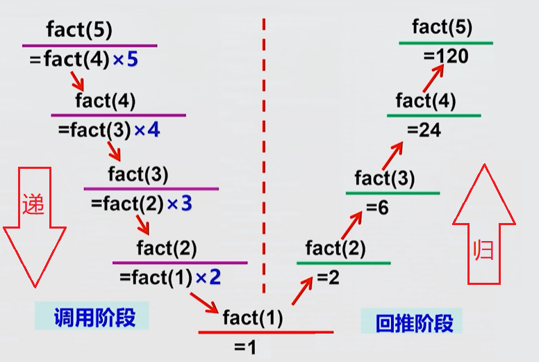

# 第 05 课 递归

递归适用场景、递归算法思想与经典问题

> 学习目标：理解递归适用的问题特点；能够用生活中的自相似现象理解递归；掌握递归函数的基本结构以及“递”和“归”的算法思想；能够分析斐波那契数列、走台阶和汉诺塔问题的递归关系；理解重复子问题，并能用记忆化减少重复计算；知道如何检查递归的结束条件、问题规模、返回过程和计算范围。

## 一、什么是递归

### 1\. 递归的概念

递归，简单说就是“自己调用自己”。它解决一个大问题时，不直接硬解，而是把它拆成一个同类的、更小的问题；如果还解不了，就继续拆小，直到遇到一个能直接给出答案的最小情况。然后，再从这个最小答案出发，一层层往回算，最终得到原问题的答案。一句话：**自己调用自己，但规模越来越小，有终止条件，最后再层层返回。**

例如，求 `1 + 2 + 3 + 4 + 5`，可以先把最后一个数拿出来：

```text
sum(5) = 5 + sum(4)
```

接下来，`sum(4)` 又是同一种问题，只是规模更小。不断拆分，最后会到达一个能直接回答的最简单情况。许多“层层包含”“不断缩小”“分成同类小问题”的任务，都可以考虑递归。

所以，递归适合处理这样的问题：**当前问题可以拆成一个或几个规模更小、但形式相同的子问题；子问题解决后，又可以用它们的结果构造当前问题的答案。**

### 2\. 自然界和生活中的递归结构

自然界和生活中有许多**看起来具有递归结构**的例子：

-   一棵树的树枝分出更小的树枝，小树枝又继续分叉；
-   河流上游由许多支流汇成，支流又由更小的溪流汇成；
-   打开套娃，大娃娃里还有小娃娃；
-   文件夹里包含子文件夹，子文件夹里还可以包含子文件夹。

它们都有“整体里包含结构相似的小部分”的特点。计算机程序可以利用这种相似性，把处理整体的方法重复用在较小部分上。


### 3\. 递归必须能够停下来

递归函数不断调用自己时，必须有一个能够直接求解的**结束条件**；每次递归还必须向这个结束条件靠近。

如果缺少结束条件，或者问题规模没有变小，递归就会一直调用下去，最后可能发生调用栈溢出。

---

## 二、递归函数的基本结构

### 1\. 递归函数是什么

一个函数在自己的函数体中调用自己，这种调用叫作**递归调用**；包含递归调用的函数叫作**递归函数**。

普通函数可以调用另一个函数：

```cpp
void hello() {
    cout << "Hello" << '\n';
}

int main() {
    hello();
}
```

函数也可以在函数体内部调用自己：

```cpp
void sayHello() {
    cout << "Hello" << '\n';
    sayHello();
}
```

这段代码只展示了“函数调用自己”的形式，没有结束条件，因此直接运行，会无限进行下去。

### 2\. 递归函数的语法结构

有返回值的递归函数通常写成：

```cpp
返回类型 函数名(参数) {
    // 第一部分：递归出口
    if (结束条件) {
        return 最简单情况的答案;
    }

    // 第二部分：递归处理
    // 把当前问题变成更小的同类问题
    return 用当前数据和递归调用的结果构造答案;
}
```

递归函数包含三个重要部分：

| 部分 | 作用 | 示例 |
|:---:|:---:|:---:|
| 结束条件 | 问题足够简单时直接返回 | `if (n == 1) return 1;` |
| 递归调用 | 继续解决规模更小的同类问题 | `f(n - 1)` |
| 返回与构造 | 利用子问题结果构造当前答案 | `return n + f(n - 1);` |

如果递归函数只负责打印等操作、不需要计算并返回结果，可以使用 `void`：


### 3\. 示例：老和尚给小和尚讲故事

老和尚给小和尚讲一个故事：

> 从前有座山，山里有座庙，庙里有个老和尚和小和尚。老和尚正在给小和尚讲故事，讲的故事是：
>
> 从前有座山，山里有座庙，庙里有个老和尚和小和尚。老和尚正在给小和尚讲故事，讲的故事是：……

如果把“讲故事”看成一个函数，它调用的还是“讲故事”本身：

```cpp
void tellStory() {
    cout << "从前有座山，山里有座庙，庙里有个老和尚和小和尚。" << '\n';
    cout << "老和尚正在给小和尚讲故事，讲的故事是：" << '\n';
    tellStory();
}
```

这个故事故意没有结尾，因此对应的函数也没有结束条件，会一直讲下去。若要让程序停下来，就需要补上停止规则，例如讲到第 `n` 层时结束：

```cpp
void tellStory(int level, int n) {
    if (level > n) {
        return;
    }

    cout << "第 " << level << " 层故事" << '\n';
    tellStory(level + 1, n);
}
```

调用 `tellStory(1, 3)` 时，`level` 会从 `1` 增加到 `4`；当 `level > n` 时，函数停止继续调用。

## 三、递归的执行过程

### 1\. 示例：递归计算阶乘

下面的函数计算 `n` 的阶乘 ：

```cpp
int fact(int n) {
    //递归出口
    if (n == 0) {
        return 1;
    }
    //递归调用
    return fact(n - 1) * n;
}
```

调用：

```cpp
fact(5);
```

输出：

```text
120
```

### 2\. 递归的执行过程

程序执行递归函数时，每次调用都会暂时保存当前函数的信息，这些信息会放入一块叫作**调用栈**的内存区域。

递归调用通常是“先一层层进入，再一层层返回”。



### 3\. 递归前和递归后的语句

语句写在递归调用前后，执行顺序会不同：

```cpp
void printForward(int n) {
    if (n == 0) {
        return;
    }

    cout << n << ' ';       // 递归调用前
    printForward(n - 1);
}
```

输出：

```text
3 2 1
```

如果把输出放到递归调用后面：

```cpp
void printBackward(int n) {
    if (n == 0) {
        return;
    }

    printBackward(n - 1);
    cout << n << ' ';       // 递归调用后
}
```

调用 `printBackward(3)`，输出：

```text
1 2 3
```

> **关键理解：** 递归调用前的语句通常先执行，递归调用后的语句要等更深层函数返回后才执行。

## 四、题目一：小范围斐波那契数列

### 1\. 题意

斐波那契数列定义如下：

```text
F(1) = 1
F(2) = 1
F(n) = F(n - 1) + F(n - 2)    n >= 3
```

给定一个正整数 `n`（`1 <= n <= 30`），输出第 `n` 项。

例如，输入 `6`，输出 `8`。

### 2\. 分析思路

要求 `F(n)`，需要先求出两个更小的问题 `F(n - 1)` 和 `F(n - 2)`，然后把它们相加：

```text
F(n) = F(n - 1) + F(n - 2)
```

当 `n` 为 `1` 或 `2` 时，答案可以直接得到，这就是递归出口。

以 `F(5)` 为例：

```text
F(5) = F(4) + F(3)
     = (F(3) + F(2)) + (F(2) + F(1))
     = 3 + 2
     = 5
```

### 3\. 参考代码

```cpp
#include <iostream>
using namespace std;

long long fib(int n) {
    if (n == 1 || n == 2) {
        return 1;
    }

    return fib(n - 1) + fib(n - 2);
}

int main() {
    int n;
    cin >> n;
    cout << fib(n) << '\n';
    return 0;
}
```

本题的范围很小，直接递归可以完成。随着 `n` 增大，相同的项会被反复计算，后面的记忆化题型会解决这个问题。

## 五、题目二：上台阶

### 1\. 题意

最底层编号为 `1`，最顶层编号为 `n`。每次可以向上走 `1` 级或 `2` 级，求从第 `1` 层走到第 `n` 层有多少种方法。

输入一个整数 `n`（`2 <= n <= 25`），输出方案数。

例如，输入 `4`，输出 `3`。三种走法可以表示为：

```text
1 + 1 + 1
1 + 2
2 + 1
```

### 2\. 分析思路

到达第 `n` 层的最后一步只有两种情况：

-   从第 `n - 1` 层走 `1` 级上来；
-   从第 `n - 2` 层走 `2` 级上来。

所以：

```text
ways(n) = ways(n - 1) + ways(n - 2)
```

按照题目的楼层编号：

```text
ways(1) = 1
ways(2) = 1
```

当 `n = 4` 时，`ways(4) = ways(3) + ways(2) = 2 + 1 = 3`。

### 3\. 参考代码

```cpp
#include <iostream>
using namespace std;

long long ways(int n) {
    if (n == 1 || n == 2) {
        return 1;
    }

    return ways(n - 1) + ways(n - 2);
}

int main() {
    int n;
    cin >> n;
    cout << ways(n) << '\n';
    return 0;
}
```

这道题和斐波那契数列的递推式相同，但初始条件要根据题目的楼层定义确定，不能只看递推式。

## 六、题目三：铺瓷砖

### 1\. 题意

有一个 `2 * n` 的浴室，使用 `2 * 1` 的小瓷砖和 `2 * 2` 的小瓷砖铺满。`2 * 1` 的瓷砖可以横着或竖着放。求铺满浴室的方案数。

输入第一行一个整数 `T`，表示数据组数；接下来 `T` 行每行一个 `n`（`1 <= n <= 20`），输出每组的方案数。

例如：

```text
输入：
3
2
8
12

输出：
3
171
2731
```

### 2\. 分析思路

假设从左往右铺，观察最右边的一部分，有三种互不重复的放法：

1.  放一块竖着的 `2 * 1` 瓷砖，剩下 `2 * (n - 1)`；
2.  放两块横着的 `2 * 1` 瓷砖，剩下 `2 * (n - 2)`；
3.  放一块 `2 * 2` 瓷砖，剩下 `2 * (n - 2)`。

因此递推关系为：

```text
tile(n) = tile(n - 1) + 2 * tile(n - 2)
```

边界情况：

```text
tile(1) = 1
tile(2) = 3
```

其中 `tile(2) = 3` 对应两块竖放、两块横放、一个 `2 * 2` 瓷砖三种方案。

### 3\. 参考代码

```cpp
#include <iostream>
using namespace std;

long long f(int n) {
    if (n == 1) {
        return 1;
    }
    if (n == 2) {
        return 3;
    }

    return f(n - 1) + 2 * f(n - 2);
}

int main() {
    int t;
    cin >> t;

    while (t--) {
        int n;
        cin >> n;
        cout << f(n) << '\n';
    }

    return 0;
}
```

这道题的关键不是马上写代码，而是先固定最右边的放法，再根据剩余部分写出递归关系。

## 七、题目四：斐波那契数列的记忆化

### 1\. 题意

仍然求斐波那契数列的第 `n` 项，但这次要求观察直接递归中的重复计算，并使用**记忆化**保存已经求过的结果。

为便于学习，本题规定 `1 <= n <= 1000000`，答案使用 `long long` 保存，答案对 1000000007 取余。

### 2\. 分析思路

直接计算 `fib(5)` 时，`fib(3)` 会在不同分支中重复出现；当 `n` 变大，重复计算会越来越多。

记忆化的做法是：

1.  先检查 `fib(n)` 是否已经计算过；
2.  如果计算过，直接返回保存的结果；
3.  如果没有计算过，递归求出答案；
4.  把答案保存到 `memo[n]`，再返回。

斐波那契数列的答案都是正数，因此可以用 `0` 表示“还没有计算”。

### 3\. 参考代码

```cpp
#include <iostream>
using namespace std;

long long mod=1000000007;//1e9+7

//策略：记忆化（空间换时间）
long long dp[1000005];//1 建表

long long fib(int n){
	//3 查表
	if(dp[n]>0) return dp[n];
	
	//第一部分：递归边界（边界条件）
	if(n==1||n==2) return dp[n]=1;
	
	//第二部分：递归处理
	return dp[n]=(fib(n-1)+fib(n-2))%mod;//2 填表
}

int main(){
	int n;
	cin>>n;
	cout<<fib(n);
	return 0;
}
```

记忆化并没有改变递归关系，只是把已经得到的答案保存下来。直接递归会反复计算，记忆化后每个状态只需要完整计算一次。

> **范围提醒：** 记忆化可以减少重复计算，但不能让 `long long` 保存无限大的数；如果 `n` 很大，还要考虑取模，或者用高精度算法进行存储和计算。

## 八、题目五：汉诺塔

### 1\. 题意

有三根柱子 `A`、`B`、`C`，`A` 柱上有 `n` 个大小不同的圆盘，大盘在下、小盘在上。要求把所有圆盘从 `A` 移到 `C`，可以借助 `B`，并遵守：

1.  每次只能移动一个圆盘；
2.  每次只能移动柱子最上面的圆盘；
3.  大圆盘不能放在小圆盘上面。

输出每一步移动，例如把一个圆盘从 `A` 移到 `C`，输出 `A -> C`。

### 2\. 分析思路

如果已经知道怎样把 `n - 1` 个圆盘从 `A` 移到 `B`，就可以这样移动 `n` 个圆盘：

1.  先把上面的 `n - 1` 个圆盘从 `A` 移到 `B`，借助 `C`；
2.  把最大的圆盘从 `A` 移到 `C`；
3.  再把 `n - 1` 个圆盘从 `B` 移到 `C`，借助 `A`。

因此，大问题由两个 `n - 1` 的小问题和中间的一次移动组成。`n == 1` 时，直接输出一步，这就是递归出口。

### 3\. 参考代码

```cpp
#include <iostream>
using namespace std;

void hanoi(int n,char A,char B,char C){
	//递归出口
	if(n==0) return;
	//递归处理
	hanoi(n-1,A,C,B);
	cout<<A<<" "<<C<<endl;
	hanoi(n-1,B,A,C); 
}

int main(){
	int n;
	cin>>n;
	hanoi(n,'A','B','C');
	return 0;
}
```

例如 `n = 3` 时，一共移动 `7` 次。移动次数满足：

```text
T(1) = 1
T(n) = 2 * T(n - 1) + 1
```