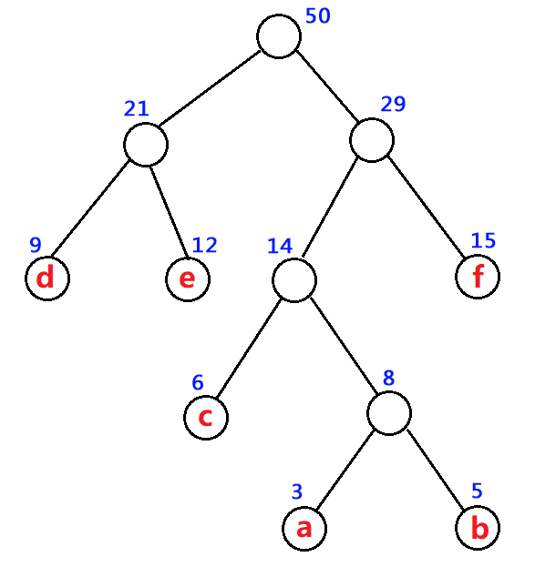

# 第 12 课 贪心算法

贪心思想、两大原理、算法结构与经典模型

> **学习目标**：理解贪心思想及其失效条件，掌握贪心选择性质与最优子结构，会按“定策略—定顺序—逐步选—维护状态—输出答案”设计贪心，了解四种证明方法(数学归纳法、反证法、替换法、交换论证法)并能分析经典题。

## 一、基本思想

### 1．什么是贪心

先记住一句话：**贪心就是每步都挑眼前最好的，选完不回头。**

- 走到岔路口，只挑看起来最划算的那条，走了就不返回去改；
- 不枚举所有方案，不把每个可能都试一遍；
- 赌的是“这一步的最优，恰好也是全局的最优”。

生活中的例子：买水果先挑最大的；结账选最短的队；做题先做会做的。

贪心最大的优点是**快**，最大的风险是**可能错**。所以学贪心，一半在学“怎么贪”，一半在学“什么时候不能贪”。

### 2．贪心不是万能的：反例

**反例一：找零钱。**

有面额 1、3、4 元的硬币，要凑 6 元。

- 贪心从大到小拿：先拿 4，再拿 1，再拿 1，一共 3 枚；
- 最优是 3 + 3，一共 2 枚。

贪心失败了。

**反例二：0/1 背包。**

背包容量 10，三件物品：

- 物品 1：重 6，价值 30（单位价值 5）；
- 物品 2：重 5，价值 20（单位价值 4）；
- 物品 3：重 5，价值 20（单位价值 4）。

按“单位价值最高”贪心：先拿物品 1，得 30，剩 4 装不下别的，总共 30。最优是拿物品 2 + 3，总共 40。

结论：**贪心之前，要论证贪心策略的正确性。**

## 二、基本原理

贪心为什么能保证正确？靠两个原理同时成立。

### 1．贪心选择性质

**贪心选择性质：每一步做出的当前最优选择，存在一个全局最优解包含它；也就是说，这个局部选择是“安全”的，不会排除掉所有全局最优解。于是可以先做这个选择，把问题缩小。**

### 2．最优子结构

**最优子结构：在已经确定某个选择属于某个最优解的前提下，剩余子问题必须取最优解；否则把剩余部分换成更优解，就能得到原问题的更优解，矛盾。因此贪心走完一步后，剩下的仍是同类型子问题，可以继续用同样方法贪。**

### 3．一句话总结

贪心能用，是因为当前贪心选择可以被某个全局最优解包含，并且做完这个选择后，剩余子问题仍要取最优解；两者结合，才能逐步构造出全局最优解。

## 三、贪心算法的结构

贪心算法通常是**按某种顺序逐步做决策，构造出解或维护当前最优状态**。它的核心是：每一步都按当前状态选择局部最优方案，并且做出后通常不回退，同时要能证明这个局部选择可以导向全局最优。

一般可以按下面几步来写：

1. **定策略**：想清楚“当前这一步，按什么规则选最优”。  
   这个策略需要满足贪心选择性质，并通常配合最优子结构。

2. **定顺序**：决定按什么顺序处理元素。

    顺序不一定是排序，可以是题目自然顺序（如跳跃游戏、均分纸牌从左到右），也可以是排序顺序（如区间调度按右端点），或用优先队列动态选择当前最优。

3. **逐步选**：按既定顺序处理每个元素，每步都按策略做局部最优选择。  
   贪心的关键是：选择一旦做出，通常不回退。

4. **维护状态**：用一个或几个变量记录当前进度和已做选择。  
   状态也可以是堆、栈、并查集、集合等数据结构，用来维护“已经做出的选择”和“当前受到的约束/进度”。

5. **输出答案**：处理完后输出构造出的解，或维护出的最优值、计数、可行性结果。  
   有些贪心构造完整解，有些贪心只维护当前最优值或可行集合。

伪代码可以写成：

```text
初始化状态

for 按某个顺序处理每个元素：
    根据当前状态，按贪心策略做局部最优选择
    更新状态

输出答案
```

判断一个算法是否属于贪心，关键看两点：

- 每步是否做了**局部最优且不回退**的选择；
- 这个局部选择是否能证明可导向全局最优。

## 四、证明方法

要证明贪心对，就是证明两件事：**每一步选当前最优，都还有一个最优解包含它（贪心选择性质）；剩下的子问题还能继续这么选（最优子结构）。**

围绕这两件事，有四种常用的证明方法：

| 方法 | 思路 | 适合 |
| :--- | :--- | :--- |
| 数学归纳法 | 归纳“前 i 步都对”，一步步推到 n | 状态可递推、单调向前 |
| 反证法 | 假设贪心不是最优，推出矛盾 | 有明确下界 |
| 替换法 | 把最优解一步步改成贪心解 | 替换某个元素不亏 |
| 邻项交换论证法 | 交换相邻两项，比较代价 | 排序类贪心 |

四种方法各管一片：归纳法对付“递推推进”的题，反证法对付“最少/最多”的题，替换法对付“选集合”的题，邻项交换对付“排顺序”的题。

## 五、证明方法举例说明

下面每种方法配一道 MarsOJ 上的题，走一遍完整证明。

### 1．数学归纳法（示范：P1670 数列分段）

**题目**：给定一个长度为 N 的正整数数列，把它分成连续的若干段，每段的和不超过 M，问最少能分成多少段。

**贪心策略**：从左往右累加，当前元素能塞进当前段就塞，超了 M 就另开一段。

```cpp
#include <iostream>
using namespace std;

int main() {
    int n, m;
    cin >> n >> m;
    int cnt = 1, sum = 0;          // 至少一段
    for (int i = 1; i <= n; i++) {
        int x;
        cin >> x;
        if (sum + x > m) {         // 塞不下了，另开一段
            cnt++;
            sum = x;
        } else {
            sum += x;
        }
    }
    cout << cnt << '\n';
    return 0;
}
```

**证明（数学归纳法）**：对“第几段”归纳。

设贪心分段为 \(G\)，任意合法分段为 \(O\)。对段号 \(i\) 归纳证明：

> 贪心第 \(i\) 段的结束位置 \(e_i\)，不早于 \(O\) 第 \(i\) 段的结束位置 \(o_i\)。

- **基础**：第一段贪心从 1 开始，在不超过 \(M\) 的前提下尽量向右扩展，所以 \(e_1 \ge o_1\)。
- **归纳**：假设 \(e_{i-1} \ge o_{i-1}\)。  
  贪心第 \(i\) 段从 \(e_{i-1}+1\) 开始，\(O\) 第 \(i\) 段从 \(o_{i-1}+1\) 开始。  
  因为 \(e_{i-1} \ge o_{i-1}\)，贪心起点不早于 \(O\) 的起点；又因为元素都是正整数，贪心在不超过 \(M\) 下尽量向右扩展，所以至少能扩展到 \(o_i\)，即 \(e_i \ge o_i\)。
- **结论**：贪心每一段都不比任意合法解结束得早，因此贪心段数不会多于任意合法解，即最少。

**要点**：单个元素超过 M 时按题意特判; 最后一段可能不超过 M ，依然要算作一段，最后要加上。

### 2．反证法（示范：P1662 合并果子）

**题目**：有 n 堆果子，每堆有若干果子。每次把两堆合并成一堆，花费的体力等于这两堆果子的重量之和。求把所有果子合并成一堆的最小体力。

**贪心策略**：每次合并当前重量最小的两堆。

```cpp
#include<iostream>
#include<queue>
using namespace std;

int main(){
	int n;
	cin>>n;
	//初始状态
	priority_queue<int,vector<int>,greater<int> > q;// 小顶堆
	for(int i=1;i<=n;i++){
		int x;
		cin>>x;
		q.push(x);
	}

	//贪心处理
	long long ans=0;//消耗体力总和
	while(q.size()>=2){
		//取最小的两个
		int a=q.top();
		q.pop();
		int b=q.top();
		q.pop();
		//更新状态
		ans+=a+b;
		//维护剩余果堆的顺序
		q.push(a+b);
	}
	cout<< ans;
	return 0;
}
```

**证明（反证法）**：

先把合并过程想成一棵树：n 堆是叶子，每合并一次，两堆就长出一个“父亲”节点，节点权等于两个孩子权之和。总花费 = 所有父亲节点的权之和。

换个算法：一堆果子每参加一次合并，它的重量就被算进总花费一次；它在树里越深，参加的次数越多。所以

```text
总花费 = Σ（每堆重量 × 这堆的深度）
```



**先证一个引理**：把任意一堆的重量变小，最小总花费不会变大。因为总花费 = Σ(重量 × 深度)，重量变小后，任何一棵树的 Σ(重量 × 深度) 都只会变小，最小值自然也不会变大。

**再反证**：

1. 设最小两堆是 a、b（a ≤ b ≤ 其余）。
2. 反设：任何一个最优方案，第一步合并都不是 a 和 b。
3. 取任一最优方案的合并树，设最深的两个叶子是 p、q（深度 d），它们是一对兄弟。
4. 把 a、b 换到 p、q 的位置，p、q 挪回 a、b 原来的位置。因为 a ≤ p、b ≤ q，且 d 更深，总花费的变化 = (a − p)·(d − a 的原深度) + (b − q)·(d − b 的原深度) ≤ 0，总花费不增。
5. 于是得到一个同样最优的方案，其中 a、b 位于最深处、是一对兄弟。而最深处的一对兄弟，正是“最先被合并”的两堆（树是自底向上长出来的）。
6. 这与反设“任何一个最优方案，第一步合并都不是 a 和 b”矛盾。

所以反设不成立，说明至少存在一个最优解第一步是合并的 a 和 b。那么，不妨先第一步先把 a 和 b 合并掉，合并后剩 n − 1 堆，重复同样论证，每一步都合并当前最小的两堆，直到最终合并为一堆。

**要点**：反证法的关键引理“重量变小则最小总代价不增大”说明了单调性，这是证明成立的根基。

### 3．替换法（示范：P1332 参加活动）

**题目**：有 n 个活动，每个活动有开始时间 l 和结束时间 r，同一时间只能参加一个活动，问最多能参加几个。

**贪心策略**：按结束时间升序排序，能参加就参加。

```cpp
#include <iostream>
#include <algorithm>
using namespace std;

const int N = 100005;
struct Node { int l, r; } a[N];
bool cmp(Node x, Node y) { return x.r < y.r; }   // 按结束时间升序

int main() {
    int n;
    cin >> n;
    for (int i = 1; i <= n; i++) cin >> a[i].l >> a[i].r;
    sort(a + 1, a + n + 1, cmp);

    int cnt = 0, last = 0;
    for (int i = 1; i <= n; i++) {
        if (a[i].l >= last) {      // 不冲突
            cnt++;
            last = a[i].r;
        }
    }
    cout << cnt << '\n';
    return 0;
}
```

**证明（替换法）**：证明贪心选的每个活动，都能“替换”进某个最优解，且个数不变。

1. 设贪心第一个选的活动是 g（结束时间最早）。
2. 任取一个最优解 S，设 S 里结束时间最早的活动是 s*。
3. 因为 g 的结束时间 ≤ s* 的结束时间，把 s* 换成 g 后，g 不会和 S 里其他活动冲突。
4. 于是替换后仍是最优解，且包含了贪心选择 g。
5. 对剩下的活动重复，归纳到底，贪心解就是最优解。

**要点**：排序关键字是结束时间，不是开始时间；`a[i].l >= last` 表示“上一个结束、这一个开始”不算冲突。

### 4．交换论证法（示范：P1677 英雄）

**题目**：有 n 个敌人，第 i 个血量 hp[i]、每秒伤害 dps[i]。你每秒对当前敌人造成 1 点伤害，血量无限；所有存活敌人每秒都对你造成伤害。求最少损失。

**贪心策略**：按 dps/hp 降序打，即先打“单位血量伤害高”的敌人。

```cpp
#include<bits/stdc++.h>
using namespace std;

const int N=25; 
int n;
struct Node{
	int hp,dps;
}a[N];

bool cmp(Node x,Node y){
	return x.hp*y.dps<y.hp*x.dps;
}
 
int main(){
	cin>>n;
	for(int i=1;i<=n;i++) cin>>a[i].dps>>a[i].hp;
	sort(a+1,a+1+n,cmp);
	int sum=0,t=0;
	for(int i=1;i<=n;i++){
		sum+=a[i].dps*a[i].hp+t*a[i].dps;
		t+=a[i].hp;
	}
	cout<<sum;
	return 0;
}
```

**证明（交换论证法）**：

假设相邻两个怪兽为 a 和 b：

- 方案1，先a后b，代价 cost1 = a.dps * a.hp + (a.hp + b.hp) * b.dps 
- 方案2，先b后b，代价 cost2 = b.dps * b.hp + (a.hp + b.hp) * a.dps 

所以，先 a 更好 ⟺ return cost1 < cost2，反复交换相邻两项，最优解就排成这个顺序。

## 七、总结

**基本思想**：贪心就是每一步都按当前状态选择“眼前最优”，并且选择后通常不回退。它快，但并非万能；使用前要先尝试举反例，确认贪心策略可能正确，再证明它确实正确。

**两个原理**：

- **贪心选择性质**：当前做出的局部最优选择是“安全”的——一定存在某个全局最优解包含这个选择，不会把所有全局最优解都排除掉。于是可以先做这个选择，把问题缩小。
- **最优子结构**：在已经确定某个选择属于某个最优解的前提下，剩余子问题必须取最优解；否则把剩余部分换成更优解，就能得到原问题的更优解，矛盾。因此贪心走完一步后，剩下的仍是同类型子问题，可以继续用同样方法处理。

两者结合，才能说明：先做当前贪心选择，再对剩余子问题继续贪心，可以逐步构造出全局最优解。

**算法结构**：定策略 → 定顺序 → 逐步选 → 维护状态 → 输出答案。

- **定策略**：想清楚当前这一步按什么规则选局部最优；
- **定顺序**：决定按题目自然顺序、排序顺序，还是用优先队列动态选择；
- **逐步选**：按策略处理每个元素，选择通常不回退；
- **维护状态**：用变量或数据结构记录当前进度、约束和已做选择；
- **输出答案**：输出构造出的解，或维护出的最优值、计数、可行性结果。

**四种证明方法**：

- **数学归纳法**：归纳“贪心前若干步不比任意合法解差”，逐步推到全部（如数列分段）；
- **反证法**：假设不存在包含贪心选择的最优解，或假设贪心不是最优，导出矛盾（如合并果子）；
- **替换法**：把某个最优解中的元素替换成贪心选择，证明结果不变差，从而存在包含贪心选择的最优解（如参加活动）；
- **交换论证法**：比较相邻两项的不同顺序的代价，说明最优顺序应满足贪心的排序规则（如英雄）。

**一句话总结**：贪心能用，是因为当前贪心选择可以被某个全局最优解包含，并且做完这个选择后，剩余子问题仍要取最优解；两者合起来，才能保证一步步贪下去得到全局最优。